# Gizlet OS

Gizlet OS builds the Linux base system and TF1 system card for the RK3326 Game Console R36S. Its 640×480 display configuration is selected at boot. The base is a read-only Debian trixie arm64 root with systemd, built from locked packages. It mounts the data partition at `/data`, shared installed software under `/data/device` and the current local profile at `/run/gizlet/profile` and `/home`, and starts the executable named in `boot.ini`. A fresh card installs the Gizlet launcher as that entry. It shows the apps installed from `.gzl` packages with the `gizlet` command and starts them.

The base includes Bun at `/usr/bin/bun`. Run `bun /home/hello.js` from SSH or the recovery shell. A JavaScript file with `#!/usr/bin/bun` and executable permissions can also serve as a `.gzl` app entry or the `boot.ini` entry.

Cards made before local profiles require a full image write. Back up any files you want to keep before flashing the card.

## Features

- **Gamepad-first Launcher.** Browse the app shelf, test buttons and sticks, and adjust brightness, volume, theme, language, and A/B mapping from the handheld.
- **Wi-Fi and SSH from Settings.** Scan for networks, enter a Wi-Fi password with the on-screen keyboard, and see the SSH login commands for the device's `.local` name and IP address.
- **Apps and background services.** Install `.gzl` packages with `gizlet` and browse them in Apps and Services. Star a package with X to add it to Home. Manage a service such as Tailscale by opening it and using the Running and Start at boot controls.
- **Handheld power controls.** See battery charge and estimated time remaining, set separate idle sleep timers for battery and charging, and suspend from the Power menu.
- **Local profiles.** Everyone who plays on the handheld can have a profile with their own Launcher settings, favorites, saves, service state and home folder, while installed apps and services are shared. Switch profiles from Settings; the handheld restarts into the new one.
- **Two-card storage.** The read-only system runs from TF1, and the data partition keeps installed apps, profiles, and settings. TF2 mounts at `/media/tf2` for user files such as games.
- **Signed Launcher and Runtime updates.** Install updates from Settings and restart to try the new pair. If the new Launcher fails to start, the system restores the previous pair.

## Screenshots

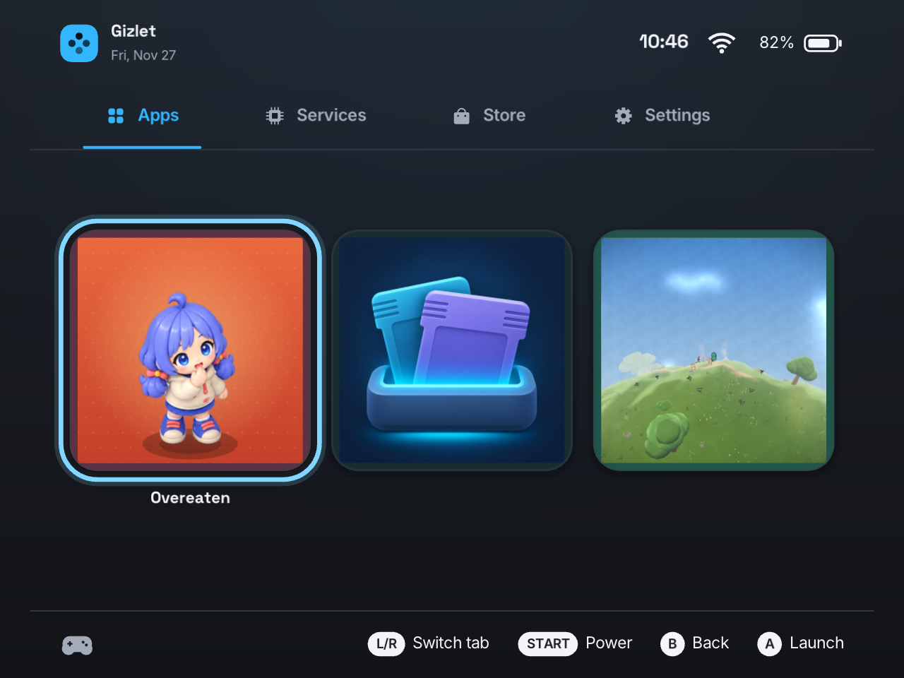

The bottom row opens **Apps**, **Services**, **Button Test**, **Settings**, and **Power**. **Store** is a placeholder. Use X in the Apps or Services grid to add or remove a shortcut on Home.

| Apps | Services |
| --- | --- |
| 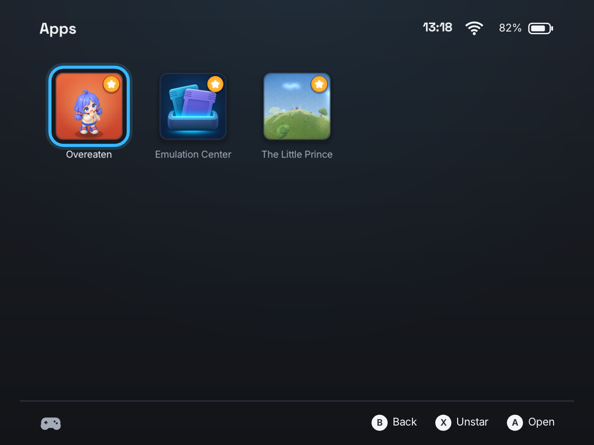 | 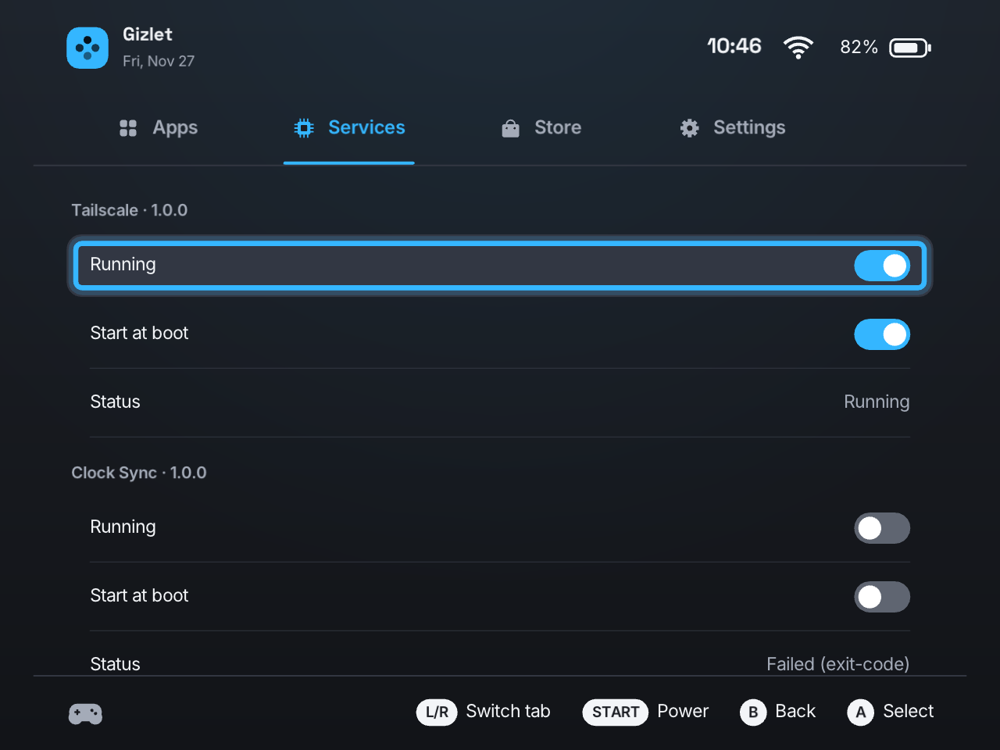 |

### Settings

| Wi-Fi networks | Joining a Wi-Fi network |
| --- | --- |
| 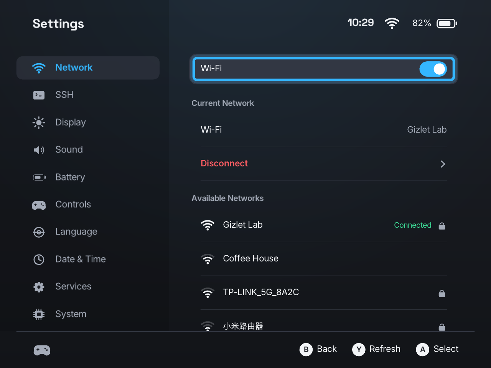 | 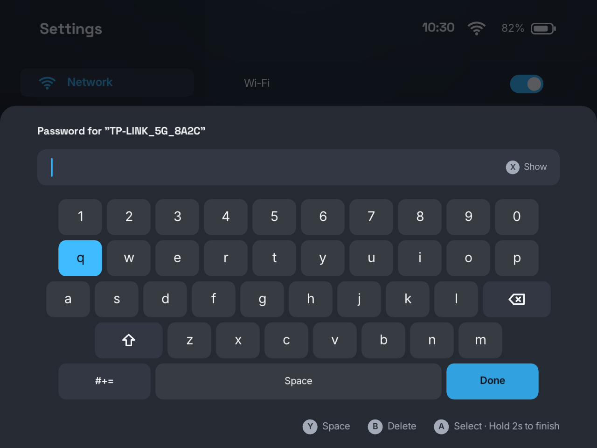 |

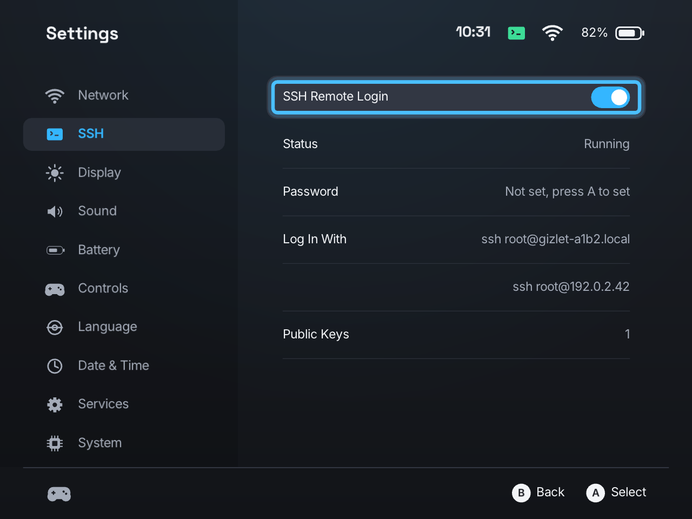

| Display | Battery |
| --- | --- |
| 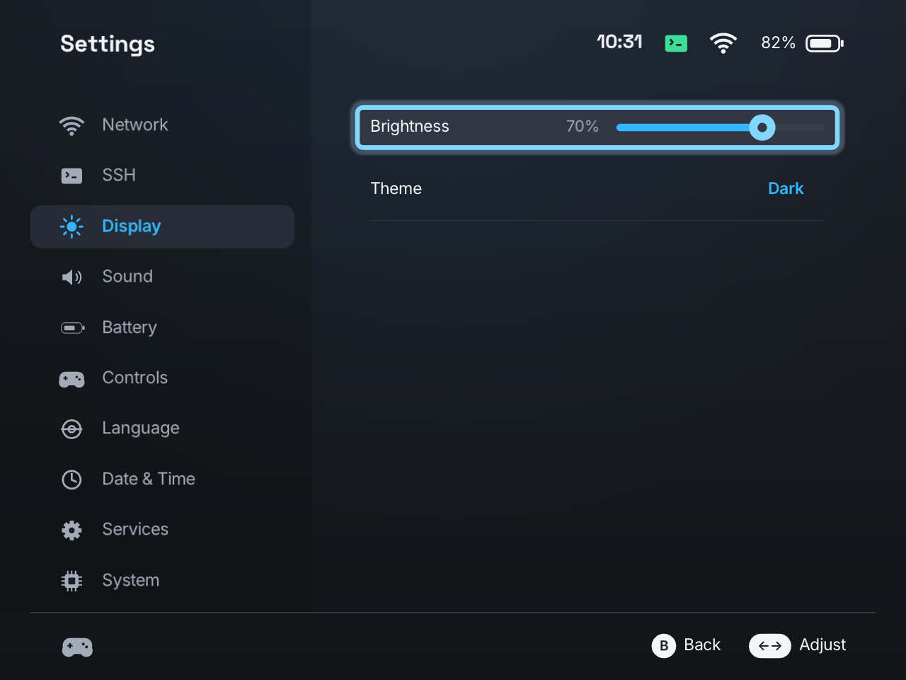 | 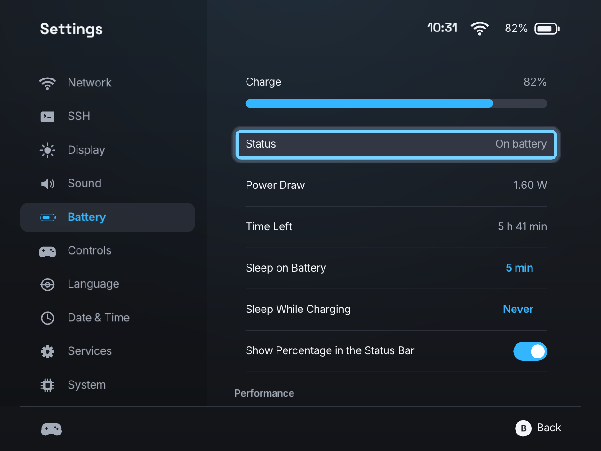 |

### Device controls

| Button Test | Power |
| --- | --- |
| 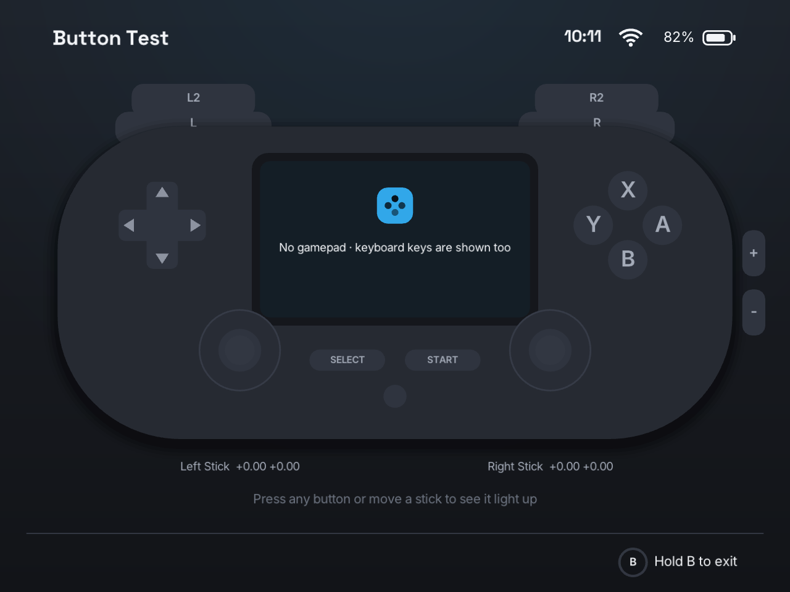 | 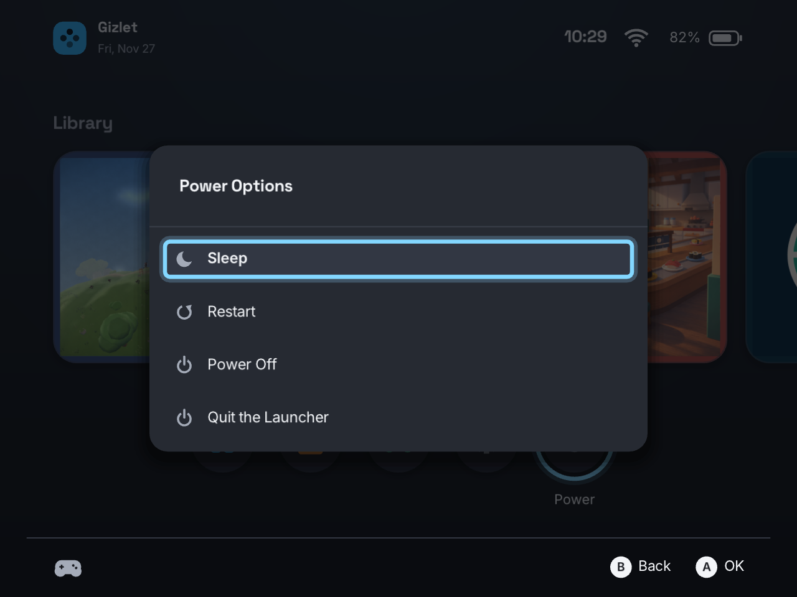 |

### Apps

| The Little Prince | Emulation Center |
| --- | --- |
| 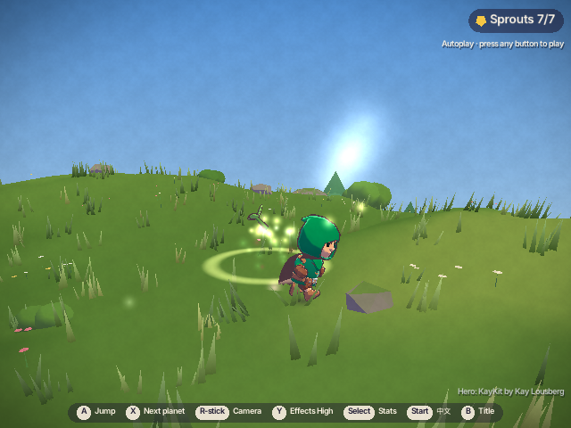 | 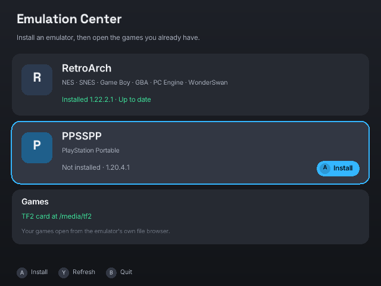 |

Desktop captures use the R36S's 4:3 layout. The Launcher uses a sample app library and simulated device and service states. See [The Little Prince](https://github.com/gizlet/little-prince) and [Emulation Center](https://github.com/gizlet/emulation-center) for more app screenshots.

## Repository layout

| Path | Contents |
| --- | --- |
| `boards/` | Per-device kernel and boot settings, card layout and hardware-specific service configuration |
| `rootfs/` | The shared Debian base with its package lock, system configuration and install rules |
| `services/` | The session, audio-jack and power programs and their systemd units |
| `runtime/` | The versioned environment for running Gizlet apps |
| `launcher/` | The Gizlet launcher |
| `targets/` | Card image assembly, service selection and per-image tests |
| `third_party/` | Pinned upstream sources and licenses |
| `devops/` | Bazel rules and build VM, release scripts and encrypted release credentials |

## Build and test

Install Bazel 9.3.3 on an Apple silicon Mac. No other build tools are needed. libkrun also supports AArch64 Linux hosts with `/dev/kvm`; that path is not yet exercised here. Bazel builds a libkrun microVM and its Debian bookworm root from pinned sources, and every native stage and image test runs inside it. [Build VM](devops/bazel/krun/README.md)

```sh
bazel build --config=r36s //targets/sd_image/gameconsole/r36s:gizlet-os-r36s
bazel test --config=r36s --test_output=errors //targets/sd_image/gameconsole/r36s:image_test //targets/sd_image/gameconsole/r36s:rootfs_test //targets/sd_image/gameconsole/r36s:boot_test
bazel test //devops/bazel/rockchip:runner_test //services/power:idle_test
```

The build produces one card image, `bazel-bin/targets/sd_image/gameconsole/r36s/gizlet-os-r36s.img`. The release workflow compresses this same image for distribution. The board guide covers [local images and display validation](boards/gameconsole/r36s/README.md#local-images-and-display-validation).

Without a serial cable, `uboot.log` and `gizlet.log` on the FAT boot partition show how far the last boot got. The card test reads back the boot stages, both BL31 copies, the partition table and the device tree. The rootfs test checks the root and data filesystems, the license notices and the installed Booter, and has `e2fsck` check the data filesystem as `flash.sh` grows it on cards of 465 MiB, 32 GB and 2 TiB, and that its update keeps the data partition and refuses another card. The QEMU test starts the kernel extracted from the image on a Cortex-A35 `virt` machine. It boots a card written by another tool, whose first boot grows the data partition, then a 16 GiB card written as `flash.sh` writes it, whose first boot grows nothing. It boots that card twice, installs a test executable through the guest console, checks its output and verifies a user file across reboot. It installs, lists, runs and removes schema 1 and schema 2 `.gzl` apps with `gizlet`, and refuses a package whose files fail `CHECKSUMS`. It installs a synthetic schema 2 service under systemd, checks that it outlives a launcher restart, starts and stops it with its child process, updates it, and restores the previous version when an update does not start. After a reboot into a custom entry, the service runs again with its state. Uninstalling it stops its processes and removes its unit, package, socket and runtime folder while the profile keeps its state. A cleanup failure reports what to do, and after another reboot nothing of it is registered and it installs again with that state. On the same card it creates a second profile and switches between the two: each keeps its own saves, favorites, home folder, service state and services started at boot over the shared apps and services, a switch stops the current profile's services before the restart, uninstalling keeps both profiles' data, the current profile cannot be deleted and deleting the other removes it whole. It also exercises recovery from invalid entries, setting the time zone and hostname across a reboot, the default hostname and mDNS on virtio-net, starting bluetoothd without a controller, starting sshd on demand, an ssh login and `scp` in both directions over virtio-net, isolation from a second data disk, and a `flash.sh` update that keeps the user's files, settings and Launcher releases. The QEMU test also installs signed Launcher and CLI bundles over a local file and HTTPS, checks version selection and pruning, and verifies that a custom boot entry still works. The delivered data partition holds `device/` with Gizlet runtime 1 and an empty `profiles/`; the first boot creates the first profile.

`third_party/` pins each upstream once: Linux, Hardkernel U-Boot, Rockchip rkbin, linux-firmware and the `gizlet/rocknix` fork that serves the kernel and U-Boot patches. A board package under `boards/` builds its kernel, device trees and boot chain from those pins. Each image target combines them with the shared rootfs, chooses optional services and their board configuration, and defines tests for the resulting card. [Image rules](devops/bazel/rockchip/README.md) · [R36S board](boards/gameconsole/r36s/BUILD.bazel) · [R36S target](targets/sd_image/gameconsole/r36s/BUILD.bazel)

The board guide covers the storage contract, local recovery and application setup. Keep the original TF1 and back up an existing data partition before writing a full image. A whole-card write replaces all three partitions. Qualification of DDR, TF1, display, UART and physical controls requires a matching handheld. [R36S guide](boards/gameconsole/r36s/README.md) · [Sources and licensing](third_party/README.md)

## CI and code review

Pull requests to `main` must pass two checks. Whenever a pull request from a branch in this repository is opened, pushed to, reopened or marked ready, `.github/workflows/triage.yml` has gizlet-bot comment `/ci` and `/codex-review` for its head, and `build.yml` and `codex-review.yml` start from that comment; drafts wait until they are ready. To run one again, a user with write access comments `/ci`, `/codex-review`, or both on their own lines (👀 on the comment). Fork pull requests are refused and never built.

- `Bazel build and test (R36S)` builds the R36S image and runs the image, boot, and OTA tests (`.github/workflows/build.yml`). It runs on the self-hosted ARM64 Linux runner that the `RUNNERS` organization variable maps to `linux-arm64` and uses `BAZEL_CACHE_DIR` for Bazel caches. If `RUNNERS` is unset, it falls back to GitHub's Ubuntu 24.04 ARM64 runner. Triage, Codex review and the check start/finish jobs run on GitHub-hosted runners.
- `Codex Code Review` reviews the diff (`.github/workflows/codex-review.yml`).

Both workflows run from `main` and use the shared [Gizlet workflows](https://github.com/gizlet/.github). Pushes to `main` build directly and refresh the Bazel caches.

## Releases

Push a `vMAJOR.MINOR.PATCH` tag on a commit in `main` to run the Release workflow. A GitHub-hosted ARM64 runner builds and tests the R36S image, runtime, and Launcher, then publishes directly to the private `gizlet-assets` R2 bucket. The R2 publishing step uses the `SOPS_AGE_KEY` organization secret to decrypt `devops/secrets/release.enc.yaml` for Launcher signing and R2 upload.

Each version lives under `releases/<tag>/`. CI uploads `manifest.json` last. All artifact paths in the manifest are relative to the version directory. `boards.gameconsole.r36s.image` gives the compressed image and its `SHA256SUMS` path, and `flash_scripts` gives the two board-specific writers. The manifest also lists the ARM64 runtime SquashFS and the signed Launcher and CLI bundle.

The release signs `manifest.json` with the same key as the Launcher bundle. Its `ota` field records the protocol, architecture, Runtime ABI, and the exact sizes and SHA-256 hashes of both artifacts. After publishing to R2, CI attaches the same `manifest.json` and `manifest.json.sig` to the matching GitHub Release. `GET https://gizlet.io/api/v1/os/releases/latest` returns the completed release's tag and versioned manifest and signature URLs. Resolve artifact paths against `https://gizlet.io/assets/releases/<tag>/`. The Launcher verifies the detached signature and uses only files from that version.

Use the version directory's `flash.sh` on macOS or Linux with `jq` installed, or `flash.ps1` in an elevated PowerShell on Windows. The entry scripts ask for a language and board, then run the board's writer with that version's image and checksum. Running the scripts from the source checkout discovers the current release through the API. The R36S image configures the supported display at boot. [Writing an R36S card](boards/gameconsole/r36s/README.md#writing-a-card)
